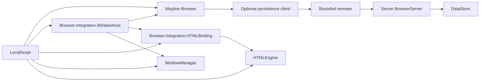
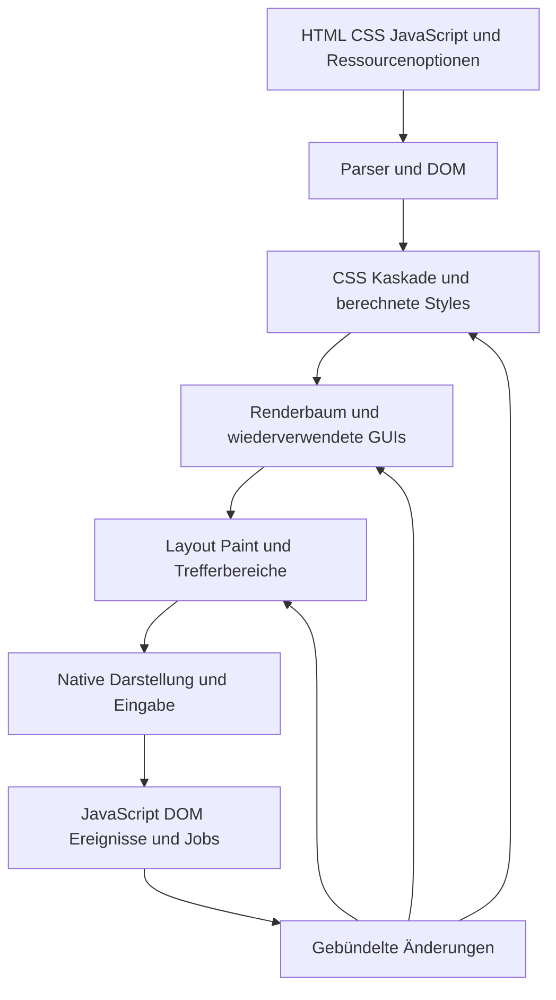

# Architektur der HTML Engine

Grundstand: 6. Oktober 2026; Mediennachtrag: 12. Oktober 2026;
Wayline integration: 15 October 2026; interner HTML-Fensterhost: 16. Oktober 2026;
modularer Start: 19. Oktober 2026.
Die Engine verarbeitet Standard-Webquellen und stellt
deren unterstützten Umfang mit Roblox-GUIs und Ressourcenhosts dar.
Dieses Dokument beschreibt Datenfluss und Zuständigkeiten. Funktionsgrenzen
stehen in den Fachprofilen des [Index](README.md), Arbeitsregeln im [Plan](../PLAN.md).

## Quellen und öffentlicher Einstieg

[examples/websites](../examples/websites) enthält bearbeitbares HTML, CSS,
JavaScript und lokale Ressourcen. [wttg2-site-publisher.cjs](../scripts/wttg2-site-publisher.cjs)
verpackt den vollständigen geprüften Originalspiel-Port für [Websites](../src/HTMLEngine/Websites);
[sync-website.py](../scripts/sync-website.py) bleibt der allgemeine Generator für einzelne Seiten.
Generierte Module werden über ihren Generator geändert. Die Demo wählt den
Website-Namen; die Engine kennt keine Tabs oder Browser-Adressleiste.

[init.luau](../src/HTMLEngine/init.luau) bietet `mountHTML`, `parseHTML`,
`parseDocument` und die öffentlichen Kataloge/Helfer. Bloßes Importieren startet
keine Seite oder Eingabeverbindungen. Beim ersten Mount werden die benötigten
Rendering-Module über [WorkContext](../src/HTMLEngine/WorkContext.luau) in
begrenzten Abschnitten geladen. Die Liste
[LoadingModules](../src/HTMLEngine/Rendering/LoadingModules.luau) wird von
[export-loading-modules.cjs](../scripts/export-loading-modules.cjs) erzeugt.

## Eigenständige HTML-Fenster — 16. Oktober 2026

Ein öffentlicher `mountHTML(target, html, options)` ohne konfigurierten
`JavaScriptServices.WindowHost` lädt bei Bedarf den internen
[StandaloneHost](../src/HTMLEngine/Rendering/StandaloneHost/init.luau).
Seine kleine [FallbackWindows-Oberfläche](../src/HTMLEngine/Rendering/FallbackWindows/init.luau)
besitzt Titelleiste, Schließen, Minimieren mit Wiederherstellen, Maximieren,
Verschieben und Größenänderung. Alle Schaltflächen bleiben passive GUI-Objekte;
ein eigener Eingaberouter setzt Hover, Press, Mauszeiger und Fokus um.
Fensterrahmen und Wiederherstellen-Controls bleiben während eines kooperativ
unterbrochenen Aufbaus verborgen; erst die fertige Geometrie wird sichtbar.
Das Laden des HTML-Moduls selbst erzeugt weiterhin keine Oberfläche oder Verbindung.
Browser und WindowManager werden dafür nicht importiert.

`FallbackWindow=false` bettet das Hauptdokument weiterhin direkt in den
übergebenen GUI-Bereich ein; zusätzliche HTML-Fenster und einfache Dialoge können
den internen Host weiterverwenden. Der Browseradapter setzt diese Option bei
beiden Mountwegen. Ein expliziter `WindowHost` hat Vorrang und verhindert das
automatische interne Hosting. `IFrameDepth>0` und `IsSrcdoc` erhalten keinen
eigenen Fensterrahmen; interne HTMLPage-/Iframe-Mounts bleiben unverändert roh.

Standardmäßig bleibt die gesamte Fensterfamilie innerhalb des ursprünglichen
Targets samt dessen Clipping. Nur `WindowParent` wählt ausdrücklich einen anderen
GUI-Elternbereich. `FallbackWindow` kann statt eines booleschen Werts eine
Tabelle mit `Title`, `Size`, `Position`, `MinSize` und `Visible` enthalten.
`FallbackServices` erlaubt die vorhandenen nativen Create/Input/PlayerGui/Task-
und RunService-Grenzen einzuspeisen; es ist kein Browsertransport.

Der Host verbindet benannte Fenster, synchron verfügbare initiale
`about:blank`-Dokumente samt Herkunft und Erstellerbasis, lebende Proxy-Referenzen,
Geometrie, `postMessage`, Vollbild im eigenen Fenster und die vorhandenen
Herkunftsprüfungen. Dokumentquellen kommen aus dem Katalog/IFrameResolver oder
einem ausdrücklich bereitgestellten `WindowResolver(base, reference)` mit
`{URL, Website={HTML, Options}}`. Unaufgelöste Adressen erzeugen keinen erfundenen
Erfolg. Ohne Browser werden zusätzliche Kontexte als eigene einfache Fenster
geöffnet; es gibt keine zusätzliche Tab- oder Adressleistenimplementierung.

`alert`, `confirm`, `prompt` und die bestehende `beforeunload`-Abfrage erhalten
eine interne Oberfläche, sofern kein entsprechender Dialoghost geliefert wurde.
Live-Abbruch durch Minimieren, Verbergen oder einen anderen Dialog antwortet
ablehnend. Erzwungener Abbau beendet zuerst die betroffenen Realms und verwirft
deren wartende Autorenfortsetzungen. Ausstehende native Close-Guards werden
abgeschlossen; späte Mounts dürfen keine Oberfläche nachträglich veröffentlichen.
Ein Größen-Griff hält auch den tatsächlichen Dokumenttarget bis zur Freigabe.
Der ursprüngliche Rückgabewert besitzt die Fensterfamilie auch nach einem
Dokumentwechsel: `page:Destroy()` beendet sie, `page.FallbackHost:GetPage()`
liefert das aktuelle Hauptdokument und `page.FallbackWindow` den ursprünglichen
Fensterrahmen. Untergeordnete Dokumente werden mit ihrem eigenen Besitzer entsorgt.

Dies ist ein begrenzter In-Game-Host: kein beliebiger HTTP-Transport, kein
vollständiger dokumentübergreifender Browserhistory-/BFCache-Vertrag. Kamera und
Mikrofon besitzen inzwischen die im Medienprofil beschriebenen Berechtigungsdialoge.
`Engine.createMediaCaptureHost` baut einen unabhängigen virtuellen Kamerahost;
der LocalScript reicht ihn als `JavaScriptServices.MediaCaptureHost` an HTML
beziehungsweise als `MediaCaptureHost` an die Browserintegration. Fensterfamilien
erhalten dieselbe Konfiguration; jeder Realm besitzt seine eigenen Tracks und
gibt sie beim Abbau frei. Der Browser selbst benötigt keine Aufnahmeimplementierung.
Eine explizit rahmenlose Einbettung erhält keine
Fenster-Vollbildgeometrie. Raw-Iframes besitzen weiterhin keinen eigenen
WindowHost; `window.open` liefert dort `null`, `allow-popups` ist nicht umgesetzt.
Sie können die erlaubte Dialogoberfläche des Elternhosts verwenden; die übrigen
Grenzen stehen im [Iframeprofil](IFRAMES.md).

Nachweise: [EngineEntry](../tests/EngineEntry.luau),
[StandaloneHTMLWindows](../tests/StandaloneHTMLWindows.luau),
[StandaloneHostLifetime](../tests/StandaloneHostLifetime.luau),
[FallbackWindows](../tests/FallbackWindows.luau) und
[WindowOpenCooperative](../tests/WindowOpenCooperative.luau).
Sie prüfen tatsächliche HTML/VM-Mounts, Eingabe, Lebensdauer und Fehlergrenzen;
native Studio-Pixel und Framezeiten sind damit nicht visuell abgenommen.

## Independent Wayline browser

The native [Wayline browser](../src/Browser/init.luau) is outside HTMLEngine and
imports only its own modules. It mounts into a supplied content Frame. The host
owns outer geometry, resizing, minimize/maximize/close, stacking and focus;
Wayline creates no second window title bar, resize grips or ScreenGui. Its compact
Chrome-inspired shell uses neutral surfaces and toolbar controls, a
single rounded address field and a narrow bookmarks bar. Home centers search and
circular shortcuts. This presentation keeps the Wayline identity and existing
module, navigation and persistence responsibilities.
[WAYLINE](WAYLINE.md) is the single detailed browser reference for Explorer
mapping, installation, input coordinates, native pages and persistent storage.

`Registry` and `Address` resolve the `wayline://` scheme, bare registered aliases,
local search and exact approved content-provider addresses. Native Home, Search,
Bookmarks, History, Settings and Guide pages use shared `Gui`, `Controls`, `Input`,
`Overlay`, `Theme`, `Tokens` and cleanup scopes. Icons share a tinted image atlas,
with Frame geometry retained until each image loads;
browser GuiObjects are permanently passive. A registered-control router owns
mouse/touch capture, drag thresholds, custom scrolling and explicit TextBox focus.
No browser hotkeys or native button activation are installed.

`Model` owns one document, its navigation stack and generation tickets. There is
no tab creation, strip, search, reorder or closed-tab collection. `Session` exports
one plain `Page` navigation/state record in version 2. Old version-1 snapshots
restore only the formerly selected document and retain its navigation state.
Snapshots contain no mounted pages, DOMs, Realms or connections. `SharedData` owns settings,
Home customization, quick links, stable bookmark/folder IDs and the latest five
hundred successful visits. Native page capture preserves serializable inputs and
scroll; reload, restoration and failures do not create visits.
Rendering failures are excluded through deferred visit recording. Theme changes
update live bindings without replacing native page state.

The supplied projects use only session memory: Browser and WindowHost do not
create a persistence transport by default, and HTMLPageDemo uses
`HTMLEngine.Storage.Memory` for origin storage. No DataStore backend is mapped in
the supplied project trees. A new play session starts with empty browser data.
Disabled no-op compatibility scripts replace the former bootstrap names so an
existing Studio tree also stops running its previous storage code. Other game
server scripts remain unmanaged and unchanged.

`Persistence/Client` remains an explicitly installed asynchronous transport. The optional
server service under `ServerScriptService/BrowserServer` keeps a validated
per-player memory copy, rate-limits remotes and coalesces writes. `Persistence/Schema`
is shared validation, not a DataStore client. Only `BrowserServer/Store` uses
DataStoreService. It acquires renewable per-player leases with revisions through
UpdateAsync, migrates versioned data, and refuses to overwrite stored data after
an unsuccessful initial load. Late client responses preserve newer local changes.
An application-owned transport and SharedData instance are supplied to all its
browser windows, while only the primary window owns saved tab-session updates.

Host snapshots preserve live serializable navigation state. Server sessions
restore only ordered current tab addresses and selection, with fresh one-entry
stacks. Explicit host snapshot wins over the server session, then Home. Ephemeral
input, overlays, focus, pending work, tweens and native instances never enter
persisted state. Closing releases resources without waiting for DataStore.

[HTMLPageDemo](../examples/HTMLPage.client.luau) connects the optional modules through
[Browser.Integration.WindowHost](../src/Browser/Integration/WindowHost.luau) and
[Browser.Integration.HTMLBinding](../src/Browser/Integration/HTMLBinding/init.luau). Both receive their
modules from the LocalScript. WindowHost mounts Wayline in the existing
WindowManager's content area, forwards focus/visibility/pointer eligibility and
resize state, and owns shared in-memory browser data. It creates no Windows10
desktop or taskbar. Popup windows may hide Back, Forward and Reload while retaining
the address field. The manager remains an independent module for arbitrary content.

The optional engine-owned `Rendering/PermissionHost` connects camera/microphone
requests to the existing dialog capability. Browser Overlay and the HTML fallback
render their own permission panel. WindowHost/HTMLBinding or StandaloneHost own
the session-wide store, keyed by origin and shared across their window family.
The JavaScript facade owns Promises and PermissionStatus lifetime. No device or
stream backend is supplied yet. Neither HTML nor Browser imports the other root
module for this feature; iframe permission delegation remains disabled.

The combined Rojo graph exposes only `HTMLEngine`, `Browser` and `WindowManager`
directly under ReplicatedStorage. Optional adapters belong to `Browser.Integration`;
demo helpers belong to `HTMLEngine.Examples` and existing checks to `HTMLEngine.Tests`.
None is loaded implicitly by a core module. The unused WaylinePage example is removed.
Optional server persistence sources remain outside the client modules and are not
installed by the supplied project files.

### Start ohne optionale Module · 19. Oktober 2026

Das LocalScript wartet einmal auf die initiale Roblox-Replikation mit
[`game.IsLoaded`/`game.Loaded`](https://create.roblox.com/docs/reference/engine/classes/DataModel#Loaded).
Danach werden optionale Rootmodule und die Teile einer installierten
Browserintegration direkt nachgeschlagen. Für einen absichtlich fehlenden
Browser oder WindowManager läuft keine eigene Timeoutwartezeit mehr.

| HTMLEngine vorhanden | Browser | WindowManager | Start im HTMLPage-LocalScript |
| --- | --- | --- | --- |
| Ja | Ja | Ja | Browser mit HTML im WindowManager |
| Ja | Nein | Ja | Interner HTML-Fensterhost |
| Ja | Ja | Nein | Interner HTML-Fensterhost |
| Ja | Nein | Nein | Interner HTML-Fensterhost |

`BrowserEnabled=false` wählt den internen Host unabhängig von optionalen
Modulen. Ein vorhandenes, aber defektes Integrationspaket erhält eine klare
Fehlermeldung. Ein während Loaded, Pflichtmodulwartezeit, erstem Frame,
Engineimport oder Websiteimport geschlossenes Start-GUI beendet seinen Start;
danach werden keine neuen Kamera-/Speicherhosts angelegt.

Die Serverstarter gehören jeweils zu ihrem Besitzer: Ohne `Browser` beendet
sich `BrowserPersistenceServer` sofort, ohne `HTMLEngine` entsprechend
`HTMLStorageServer`. Vorhandene Pakete werden vor Imports beziehungsweise
Backendinitialisierung geprüft. Der eigentliche Speichervertrag bleibt gleich.
Die unabhängige Browserdemo in `browser.project.json` benötigt nur Browser;
WindowManager lässt sich über seine eigene API mit beliebigem Inhalt verwenden.

`HTMLPageStartup` prüft die Startmatrix und Abbrüche an den tatsächlichen
LocalScript-Grenzen. `BrowserPersistenceStartup` prüft 13 Browser- und elf
HTML-Storage-Startfälle anhand der echten Serverquellen. Der
[unabhängige Review](../build/module-startup-20261019/root-startup-independent-review.json)
und die bestehenden montierten Standalone-/Browser-/Fenstertests ergänzen
diese Bootstrapgrenzen; dies ist kein neuer vollständiger Engine- oder Studio-Sichtvergleich.

Die initiale HTMLPage-Präsentation wartet auch auf die abgeschlossene
Skriptinitialisierung. Ein während des Runtime-Konstruktors fertiges
Zwischenlayout beendet dessen LoadingWork nicht. Nach der Initialisierung folgt
ein ausdrücklicher Präsentationsversuch, selbst ohne neue Geometrie.
Hintergrundmeldungen zur Bildgeometrie verwenden einen abbrechbaren VM-Eintritt;
der allgemeine strikte Dokumentzugriff bleibt unverändert. Die
[Ladebeschreibung](LOADING-PERFORMANCE.md#initialisierungsbarriere-bei-zwischenlayouts--19-oktober-2026)
führt Reproduktion und Nachweise.

WindowManager now contains the complete window/dialog area imported from
`haha.rbxmx`. Its `Windows`, `Dialogs`, `UI` and `Framework` children own the
original chrome, shadows, controls, animations, snap preview and MessageBox.
The root and its public Window adapter preserve the application's existing API.
Layers stay inside the supplied target; Router adapts the imported controls to
the existing passive mouse/touch input and retains HTML resize deferral.
There is no Windows10, desktop, taskbar or application dependency. Modal eligibility
is also enforced by the browser/HTML bridge. The former native `wayline://windows`
page is kept only in the [regression archive](../tests/fixtures/retired-native-window-demo-20261016.json).
The local website catalog now contains the original Wiki-I port with 15 selected
destinations and their subpages. Former manual pages remain only as non-served
inputs for existing regression tests. Routes and source boundaries are documented
in [WEBSITES](WEBSITES.md#wiki-i-originalseiten--19-oktober-2026).
The API and verification boundary are documented in [WEBSITES](WEBSITES.md#eigenständige-fenster--14-oktober-2026).

The HTML binding provides only the registered local website catalog. A navigation
ticket is bound to its tab/generation; stale mounts are discarded. Native page
switches release obsolete HTML sessions. HTML input is scoped per visible and
focused tab, and provider capture stores serializable scroll/navigation data.
This adapter does not promise arbitrary HTTP rendering or a full joint
Toolbar/JavaScript-history/BFCache model. Background HTML timers and audio remain
subject to their existing engine hosts.

`JavaScriptServices.WindowHost` remains an optional injected engine capability.
[BrowsingWindows](../src/HTMLEngine/JavaScript/BrowsingWindows.luau) and
[RealmAccess](../src/HTMLEngine/JavaScript/RealmAccess.luau) own bounded native-window
handles and origin-guarded DOM/callback access, without importing Browser or
WindowManager. Structured messages use the existing clone/task path. The engine's
[Fullscreen](../src/HTMLEngine/JavaScript/Fullscreen.luau) and
[FullscreenHost](../src/HTMLEngine/Rendering/FullscreenHost.luau) separate web state
from Roblox element presentation. Raw HTMLPage mounts without a window host
expand fullscreen only inside their own target; public standalone mounts use the
internal host above. HTML alone does not load either optional top-level module.

The default project contains the combined application. After initial Roblox
replication, `HTMLPageDemo` discovers optional root modules immediately. If Browser
or WindowManager is absent, it mounts Engine directly with its internal window
host and the selected website. An installed but invalid integration still reports
its startup error. The independent browser project contains neither HTMLEngine
nor WindowManager. The HTML-only project explicitly sets `BrowserEnabled = false`
and skips optional-module discovery. Fonts remain
under `StarterPlayerScripts/Fonts`; `HTMLPageDemo` remains directly under
StarterPlayerScripts. The former SVG laboratory remains outside active runtime
modules. Detailed HTML-window limits remain in the
[website profile](WEBSITES.md#eigenständige-fenster--14-oktober-2026).

## Verarbeitung einer Seite

[HTMLPage](../src/HTMLEngine/Rendering/HTMLPage.luau) besitzt die gemountete Seite
und verbindet diese Schritte, Scrollbereiche, Ressourcen, Scheduler und Abbau.
Der [HTML-Parser](../src/HTMLEngine/HTML/Parser.luau) erzeugt Dokument/Elementbaum;
die CSS-Module lösen Selektoren, Kaskade, Vererbung und Werte auf.
[RenderTree](../src/HTMLEngine/Rendering/RenderTree.luau) baut die zugeordneten
GUI-/Layoutobjekte. Layoutmodule berechnen ihre Geometrie; Renderingmodule
schreiben Darstellung, Effekte und Ressourcen.

[HTMLScripts](../src/HTMLEngine/Rendering/HTMLScripts.luau) verbindet die
JavaScript-[Runtime](../src/HTMLEngine/JavaScript/Runtime.luau) mit der Seite:
DOM-/Controländerungen, Jobs, native Ereignisse, Geometrie, Auswahl, Animation,
Top Layer und Ressourcen. [VM](../src/HTMLEngine/JavaScript/VM.luau) führt den
geparsten JavaScriptcode aus. Ein Resize erzeugt keine neue Realm.

## Modulverantwortung

| Verzeichnis | Verantwortung |
| --- | --- |
| [HTML](../src/HTMLEngine/HTML) | Parser, Dokumentinformationen, Elementkatalog und VM-freier Medienauswahlkern |
| [DOM](../src/HTMLEngine/DOM) | Knoten, gemeinsame Attribut-/Dokument-/Formsemantik und Shadow-Baumgrundlagen |
| [CSS](../src/HTMLEngine/CSS) | Syntax, Selektoren, Kaskade, Eigenschaften und Werte |
| [Layout](../src/HTMLEngine/Layout) | Block/Inline/Flex/Grid/Tabelle, Maße und Dirty-Abhängigkeiten |
| [Rendering](../src/HTMLEngine/Rendering) | Seitenscheduler, Renderbaum, Reconcile, Paint, Animation und native Ressourcenhosts |
| [Input](../src/HTMLEngine/Input) | Trefferprüfung, Hover, Fokus, Auswahl und native Eingabeanbindung |
| [Controls](../src/HTMLEngine/Controls) | Gemeinsame Formzustände, Defaults und Control-Darstellung |
| [JavaScript](../src/HTMLEngine/JavaScript) | Sprache/VM, Objektmodell, Web-DOM/APIs, Ereignisschleife und Hostverträge |
| [SVG](../src/HTMLEngine/SVG) | SVG-Parsing, Szenen, Raster, Ressourcen und SVG-spezifische Interaktion |
| [Navigation](../src/HTMLEngine/Navigation) | Gemeinsame URL-/Navigationsgrundlagen |
| [Storage](../src/HTMLEngine/Storage) | Client-/Serververtrag für Roblox-Speicherung |
| [Diagnostics](../src/HTMLEngine/Diagnostics) | Ausdrücklich angeforderte Hostfähigkeitsdiagnosen |
| [Websites](../src/HTMLEngine/Websites) | Generierte, ausgelieferte Websitequellen und Zuordnungen |

JavaScript-DOM-APIs liegen in `JavaScript`, die gemeinsame Seitenrepräsentation
und Darstellung in DOM/Rendering/Layout. Eine neue Web-API braucht beide Seiten
nur dann, wenn ihre Semantik tatsächlich native Darstellung oder Eingabe verlangt.
Native Robloxdienste werden über Hosts angebunden; die VM erhält dadurch keine
beliebigen Roblox-Dienstrechte.

[AttributeStore](../src/HTMLEngine/DOM/AttributeStore.luau) hält interne
Attributschlüssel von öffentlichem QName und Namespace-/LocalName-Identität
getrennt; DOM, Selektoren und eingebettetes SVG lesen dieselbe Repräsentation.
[DocumentAccessors](../src/HTMLEngine/DOM/DocumentAccessors.luau) verbindet
Dokumentzugriffe mit den Hostmetadaten, [FormOwner](../src/HTMLEngine/DOM/FormOwner.luau)
die Formzuordnung mit DOM und nativen Controls. Semantische Grundlagen werden
so gemeinsam korrigiert, ohne eine zweite Rendererimplementierung der DOM-Regeln.

[MediaSelection](../src/HTMLEngine/HTML/MediaSelection.luau) hält ausschließlich
Quellenreihenfolge, Auswahlepochen, Versuche und den lebenden Kandidatenzeiger.
Resolver, Fähigkeiten, Ereignisse und Scheduler werden injiziert; der Kern
öffnet weder eine Realm noch native IO. [AudioElements](../src/HTMLEngine/JavaScript/AudioElements.luau)
verbindet ihn mit den vorhandenen Audiozuständen und
[AudioHost](../src/HTMLEngine/Rendering/AudioHost.luau) mit dem nativen Sound.
Queued Slots geben beim Abbau ihren geliehenen Kontext und Zustand frei.
Die produktiven No-Realm-/Video-Wege verwenden inzwischen den gemeinsamen
Auswahlkern und native Medienbesitzer. Ihre angebundenen Quell-, Retry-, Lazy-
und Besitzergrenzen sowie verbleibende Backendgrenzen stehen im
[Medienprofil](MEDIA.md) und [Ladeprofil](LOADING-PERFORMANCE.md); die
Kernanbindung ist kein Nachweis vollständiger nativer Medienkonformität.

## Änderungen und Wiederverwendung

[DOMReconcile](../src/HTMLEngine/Rendering/DOMReconcile.luau) überträgt strukturelle
DOM-Änderungen in den vorhandenen Renderbaum. [DirtyLayout](../src/HTMLEngine/Layout/DirtyLayout.luau)
und [LayoutJob](../src/HTMLEngine/Rendering/LayoutJob.luau) bündeln notwendige
Layoutarbeit. Paintänderungen, neue Geometrie und neue Struktur haben getrennte
Pfade; eine Mutation bedeutet keinen vollständigen Remount.

Wenn ein Block höher wird, werden abhängige Container und nachfolgende Positionen
aktualisiert. Unveränderte Maße, DOM-Knoten, Controls und GUI-Objekte können
erhalten bleiben. Eine Positionsänderung allein erfordert keinen SVG-Szenenneubau;
neue Größe, Inhalte oder Ressourcen können neue Rasterarbeit benötigen.
Größenproben von Grid/Flex und positionierten/atomaren Boxen verwenden
[LayoutProbe](../src/HTMLEngine/Layout/LayoutProbe.luau): Ihr temporärer lokaler
Ursprung verschiebt den behaltenen Elternframe nicht auf dem Bildschirm, wenn
der Layoutworker zwischen Frames pausiert. Die endgültige Platzierung bleibt
Aufgabe des jeweiligen Layoutmoduls.

[LayoutMeasurement](../src/HTMLEngine/Layout/LayoutMeasurement.luau) kopiert ausschließlich die Geometriearbeit der Probe. Live-Audio-/Videoleases, iframe-Kindseiten und IMG-Zustände bleiben opak; Runtime-/Ressourcenhostfelder werden nicht durchlaufen. Cachepublikation stammt aus tatsächlichen Words-/BlockImage- und geometrischen Markerbesitzern, nicht aus beliebigen gleichnamigen Items-Feldern. Der [begrenzte Nachweis](CSS-ATELIER-20261007.md#live-ressourcen-außerhalb-des-messgraphen--12-oktober-2026) hält diese Trennung gegen echte Renderer- und Live-Ownerpfade.
Konkrete Wiederverwendungsgrenzen stehen in [DIRTY-LAYOUT](DIRTY-LAYOUT.md),
[LOADING-PERFORMANCE](LOADING-PERFORMANCE.md) und [SVG-PERFORMANCE-REVIEW](SVG-PERFORMANCE-REVIEW.md).

## Besitz und Abbau

Die gemountete Seite besitzt Verbindungen, Jobs, Ressourcenhosts und die Realm.
Ihr Abbau beendet diese Arbeit. Asynchrone Antworten werden gegen den aktuellen
Besitzer/Ladezustand geprüft, damit veraltete Ergebnisse keinen Erfolg oder Paint
auf einer zerstörten Seite auslösen. Shared Ressourcen benötigen explizite Grenzen
und Freigabe; Textmaß-Wiederverwendung bleibt elementlokal.

Die initiale Darstellung wird bis zum vorbereiteten Zustand verborgen; Resize
und spätere Mutationen verwenden die vorhandene Seite. Der budgetierte Ladeweg
ist kein Nachweis ruckelfreier nativer Frames auf jedem Gerät.
HTMLPage prüft dafür aktuelle Poster-Leases, geschachtelte Posterpublikation,
laufende Scheduler-/Geometrie-Flushes und die vorhandenen Layout-/Ressourcengates.
Ein Cancel darf den Root während eines kooperativen SVG-Klonens nicht vorzeitig
zeigen. Bestehende Abschlusswege wecken die Präsentation wieder; Fehler erhalten
ihren ursprünglichen Wert. Die
[Initialprüfung](../tests/PosterPresentation.luau) belegt diese atomare
Engine-Policy, keine allgemeine progressive Browser-Paintregel.

## Erweiterung und Nachweis

Eine Funktion ist erst durch die Verbindung ihrer benötigten Schichten benutzbar:
Syntax/DOM-Eigenschaft, Invalidierung, Layout/Paint und gegebenenfalls Host.
Katalogstatus oder vorhandene Methodennamen beweisen diesen Gesamtweg nicht.
Das [API-Register](JAVASCRIPT-API-REGISTER.md) dokumentiert Erreichbarkeit,
Fachprofile Verhalten/Grenzen, [Prüfprotokolle](PROJECT-REVIEW.md) datierte Nachweise.

Der gezielte Mediennachtrag vom 12. Oktober besteht unabhängig mit 17 Suiten
und tatsächlichem Exit 0 (`build/core-poster-independent-seventeen.log`):
[PosterPresentation](../tests/PosterPresentation.luau),
[MediaSelection](../tests/MediaSelection.luau) und
[MediaSelectionAudioOpen](../tests/MediaSelectionAudioOpen.luau) samt Nachbarn,
verpflichtenden kompakten Ressourcen-/Kernprüfungen und frischen isolierten
GC-Tails. Noch kein vierzehnter Gesamtlauf. Native No-Realm-/Videoauswahl,
AudioHost-Abbau vor einer gehaltenen nativen Fortsetzung und Studio-Pixel
bleiben im [Audioprofil](JAVASCRIPT-AUDIO-20261006.md#vm-freier-auswahlkern-und-audio-reentranz--12-oktober-2026)
und [Ladeprofil](LOADING-PERFORMANCE.md#12-oktober-2026-initiale-poster-präsentation)
getrennt offen.
